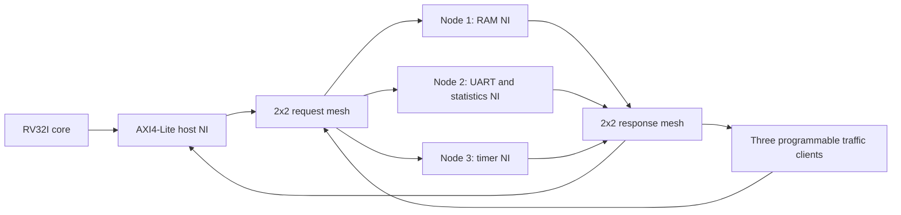

# P15: 2-D mesh Network-on-Chip

Synthesizable SystemVerilog for a credit-controlled wormhole mesh, AXI4-Lite
packet bridges, and a standalone RV32I SoC demonstration. The supplied image is
the requirements baseline. The repository was empty, so the demo supplies its
own processor and peripherals rather than claiming to modify an unavailable
VL326 implementation.



The baseline has five ports per router, four flits per input, deterministic XY
routing, a separable round-robin allocator, packet ownership through the tail,
and `IDLE / ROUTE / ACTIVE / WAIT_CREDIT` input states. A `FAST=1` variant merges
idle detection and route computation. Optional ESPRESSO-minimized route and
arbiter circuits are checked against reduced BDDs and the behavioral design.

The mesh supports 2×2 and 3×3 configurations; the included SoC address map is
the four-node 2×2 configuration. Requests and responses use physically separate
meshes to avoid protocol-level cyclic dependencies.

## Run

From the repository root in the Debian 13 cloud environment:

```sh
bash scripts/setup.sh
source scripts/env.sh
make test
make benchmark
make synth
```

`setup.sh` installs user-local tools under `/workspace/toolchain`, leaving
system directories alone. Signed Debian metadata and package checksums remain
enabled. The development tools are Icarus Verilog, Yosys/ABC, GCC for RV32I,
Python, PyEDA, NumPy, and Matplotlib. On other hosts, install those tools using
the host's supported package manager and install `requirements-dev.txt` in a
virtual environment. `make` uses system tools when no cloud-local installation
exists. No Git worktree is needed; use the existing checkout.

| Command | What it verifies or produces |
| --- | --- |
| `make model-test` | Per-cycle comparison of ready, valid, and every received flit; 2×2/3×3, both pipelines, both logic implementations |
| `make axi-test` | AW/W independence, response backpressure, byte enables, decode errors, reset, concurrent read/write requests, live uniform traffic |
| `make soc-test` | Real compiled RV32I firmware, instruction/data traffic over NoC, memory/timer checks, live hotspot traffic, UART serial decoder |
| `make core-test` | 25 directed RV32I checks, branches/jumps, random bus delays, illegal/misaligned instruction behavior |
| `make stats-test` | C++ HLS algorithm and exact fixed-point RTL comparison, clamp/saturation/reset/idle behavior |
| `make traffic-test` | Hardware uniform/hotspot generators, backpressure, loss/duplicate/data checks |
| `make formal` | CTL finite abstractions, RTL induction, XY dependency graphs, actual mixed-turn RTL deadlock and XY control |
| `make elaborate` | Whole-SoC synthesis elaboration, hierarchy checks, no inferred latches |
| `make logic` | Regenerate checked-in ESPRESSO logic and BDD/equivalence report |
| `make benchmark` | Seeded uniform/hotspot latency and throughput CSV/SVG curves |
| `make synth` | Baseline/fast/ESPRESSO router Xilinx 7-series technology mapping |

Tests stop on failure. Generated logs, waveforms, firmware, and reports live in
`build/`. Reviewed measurement snapshots are in [results](results/README.md).
The waveform `build/deadlock.vcd` is an **expected failing routing experiment**;
the production SoC never enables mixed XY/YX routing.

## What is implemented and what is pending

RTL simulation, cycle-model comparisons, finite CTL checks, RTL induction,
firmware execution, UART decoding, and open-source router mapping can run here.
The actual FPGA part, board pinout, Vivado, Vitis HLS, and physical board were
not provided. There is **no measured board Fmax, bitstream, Vivado/XSim result,
or physical hardware result**. The Tcl flows are supplied for those steps; they
require the exact FPGA part and reviewed constraints.

The formal results have explicit scope: arbitration/credit RTL safety and
arbitration progress are proved; CTL network results use stated resource
abstractions. Whole-SoC RTL liveness is not claimed. See
[verification assumptions](docs/verification.md).

The standalone core implements unprivileged RV32I integer operations with
serialized accesses, FENCE, and EBREAK halt. It has no interrupts, CSR/privileged
architecture, multiply/divide, compressed instructions, or OS support. Directed
tests and the demo are not an official RISC-V compliance certification.

The statistics engine shares an iterative divider to avoid a large
combinational divider. It backpressures response consumption while busy. This
affects SoC transaction latency; raw-router benchmark curves do not include
the instrumentation cost. See [statistics](docs/architecture.md#statistics).

## FPGA continuation

```sh
make firmware
vivado -mode batch -source fpga/xsim.tcl
vivado -mode batch -source fpga/build.tcl -tclargs ACTUAL_PART /absolute/board.xdc ACTUAL_CLOCK_HZ 0
vivado -mode batch -source fpga/program.tcl -tclargs build/vivado/noc.bit
```

Use the board's documented oscillator and a real UART-capable PL pin/header.
On boards whose USB-UART is wired only to the Zynq processing system, a PL
UART needs appropriate routing or an external USB-UART adapter. The ARM
processing system is not used as a substitute for RV32. No board pins are
invented in this project. See [FPGA workflow](docs/fpga.md).

## Design notes

- [Architecture, packet fields, timing, registers, and statistics](docs/architecture.md)
- [Formal scope, assumptions, test evidence, and deadlock](docs/verification.md)
- [Research choice and measurement method](docs/research.md)
- [FPGA bring-up and legacy SoC integration](docs/fpga.md)
- [Requirements and acceptance matrix](docs/requirements.md)

