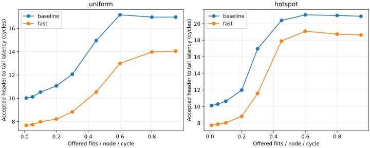
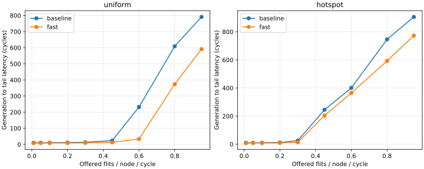
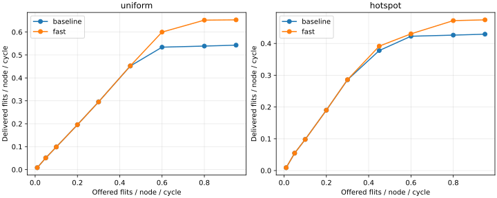
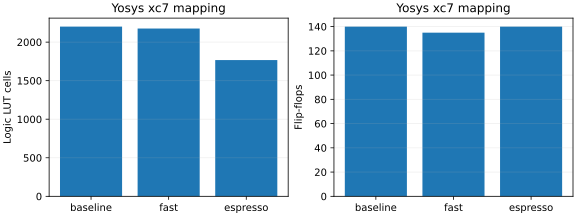

# Measured development results

These are cloud simulation and open-source mapping results from 2026-10-21.
They are not physical FPGA measurements. Commands and formal assumptions are
documented in the repository README and `docs/`.

| Metric | Baseline | Fast pipeline |
| --- | --- | --- |
| Zero-load one-flit corner→corner latency | 10 cycles | 7 cycles |
| Peak observed uniform delivered rate | 0.54285 | 0.65320 |
| Peak observed hotspot delivered rate | 0.42925 | 0.47435 |
| Standalone router logic LUT cells (Yosys xc7) | 2201 | 2176 |
| Standalone router flip-flops | 140 | 135 |
| Standalone router RAM32M primitives | 55 | 55 |
| Physical Fmax | Unmeasured | Unmeasured |

Rates are flits/node/cycle, averaged across seeds 7 and 19 at the best offered
rate in the tested sweep. The run is finite (3000 cycles, 500 warmup), so these
are observed peaks, not proven saturation throughput. See source backlog and
outstanding traffic in [traffic.csv](traffic.csv).

ESPRESSO-minimized baseline mapping uses 1767 logic LUT cells, 140 flip-flops
and 55 RAM32M primitives. RAM primitives use additional distributed memory
resources; the logic LUT count alone is not total physical LUT occupancy.
All three router maps exclude the core, AXI NIs, peripherals, statistics and
board I/O. Timing and full-system fit require Vivado on the selected part.

Verification evidence:

- [UART output from the actual simulated serial-pin test](soc_uart.txt)
- [Validation record](validation.txt)
- [Formal proof and counterexample summary](formal_results.json)
- [ESPRESSO/BDD exhaustive checks](logic_results.json)
- [Router mapping cell breakdown](router_mapping.json)
- [Benchmark summary](benchmark_summary.json)
- [Source hashes for this snapshot](source_manifest.json)

The instrumented SoC uses a shared iterative statistics divider per client
and backpressures responses. Both demos execute 2481 sampled CPU transactions
and drain 72 background reads in these runs. Their end-to-end latencies are
instrumentation-limited; the plots above measure the raw mesh instead.
